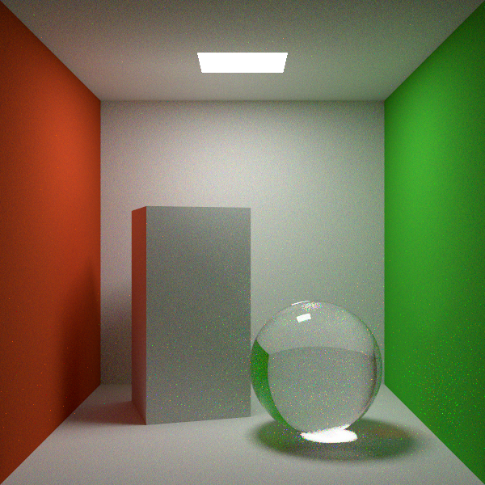
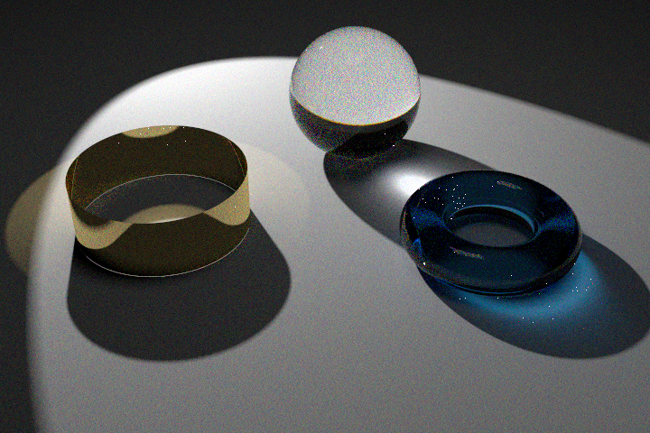
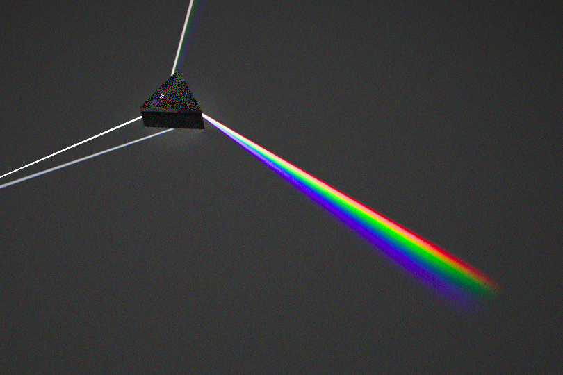
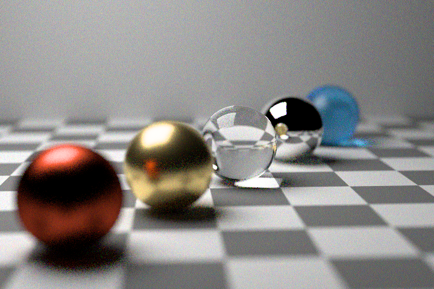

# Path Tracer examples

Four documents for the [Path Tracer plugin](../../python/plugins/pathtracer/README.md). Open one in
Raytatouille Fusion and choose *Camera image* in the Path Tracer panel: the materials, the sources,
the camera and the method are part of the document. *Show camera* draws the viewing pyramid,
*Show light paths* some paths from the sources, *Irradiance* the light on the faces.

| | Document | Shows |
|---|---|---|
|  | [`cornell-box.rttf`](cornell-box.rttf) | A room of 550 mm with a red and a green wall, a lamp in the ceiling, a block and a ball of glass: the walls colour the light they pass on, the ball throws a caustic. Reflectances by wavelength, bidirectional. |
|  | [`caustics.rttf`](caustics.rttf) | A spot on a table, a ball of strongly dispersing glass (Abbe number 28), a ring of blue glass (absorption by wavelength) and a band of polished gold: the ball gathers the light into a bright spot with coloured rims, the ring into blue figures, the band into the heart-shaped curve of a coffee cup. Bidirectional. |
|  | [`prism.rttf`](prism.rttf) | A thin sheet of white light grazes a table and meets a prism of heavy flint glass (n = 1.785, Abbe number 25.7) at the angle of least deviation: the colours leave it as a fan, 31 wavelengths from 400 to 700 nm; part of the light is reflected at the faces. Bidirectional. |
|  | [`depth-of-field.rttf`](depth-of-field.rttf) | Five balls on a chequered floor under a soft light – red paint (glossy), brushed gold (metal), glass, a mirror and frosted blue glass – seen through a lens of 14 mm radius that is sharp on the glass ball. Path tracing. |

**Colours.** The plugin computes with single wavelengths and shows grey images: the sum, and with
*Also per wavelength* (on in these documents) one image per wavelength. The colour pictures above
are put together from those images by `make_examples.py` – every wavelength in its colour (CIE
1931 observer), equal power on all of them as white. In the application you see the grey images.

**Time.** The documents ask for 120 to 160 samples per pixel; with the C++ kernel (package
`pathtracer`) that takes from about half a minute (depth of field) to a few minutes (Cornell box)
on a laptop with six cores and nothing else to do, with the NumPy kernel far longer – lower *Samples* or the camera's pixels there. The pictures above
were computed at 1.5 times the size with 1.5 times the samples per pixel.

**Making them.** `make_examples.py` writes the documents; the scenes are short functions there
(geometry as NURBS: rectangles, boxes, balls, a ring, a band, a prism with trimmed faces), to
change or to copy from:

```
python make_examples.py                          # the documents
python make_examples.py --render                 # and the pictures (the plugin's Python: NumPy, pathtracer)
python make_examples.py --render --scale 0.5 prism     # one scene, half the size
```

What these scenes cannot show: light that reaches a matt surface through glass and is seen
through glass again (the table under the prism, seen through it) is found by *photon mapping*
only – the other methods leave it dark.
